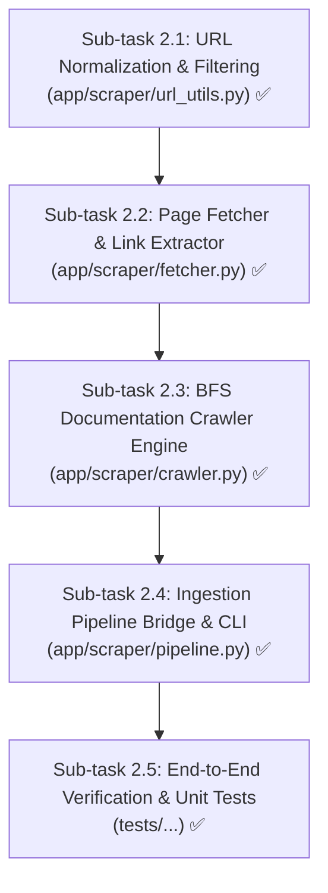

# Phase 2: Web Scraper & Documentation Crawler — Execution Plan

## Objective
Build a modular, robust web scraper and documentation crawler that crawls documentation sites, extracts clean content and links, stores raw HTML/metadata locally in `data/scraped/`, and seamlessly feeds into the Phase 1 ingestion pipeline for Qdrant indexing.

---

## Task Decomposition (Small Functional Goals)

### Sub-task 2.1: URL Normalization & Filtering (`app/scraper/url_utils.py`)
- [x] Goal: Implement URL cleaner and validator to prevent crawl loops, deduplicate URLs, and reject non-HTML binary assets.
- [x] Functions:
  - `clean_url(url: str) -> str`: Remove URL fragments (`#section`), normalize trailing slashes, remove tracking query parameters (`utm_*`, `ref`).
  - `is_same_domain(url: str, base_domain: str) -> bool`: Strict or subdomain matching to avoid crawling external internet.
  - `is_valid_crawl_target(url: str, base_url: str, allowed_prefix: str = None) -> bool`: Check if URL is HTTP/HTTPS, matches domain, within optional path prefix, and not an image/binary/archive asset.
  - `url_to_filename(url: str) -> str`: Safe filesystem filename derivation from URL path.
- [x] Verification: 9 unit tests in `tests/test_url_utils.py` passing (100%).

### Sub-task 2.2: Page Fetcher & HTML Extractor (`app/scraper/fetcher.py`)
- [x] Goal: Robust HTTP fetcher with connection pooling, retries, headers, and clean HTML content extraction.
- [x] Functions:
  - `PageFetcher`: Class managing `requests.Session`, exponential backoff retry on transient errors (429, 502, 503), timeout enforcement.
  - `fetch_page(url: str) -> FetchResult`: Fetches page, verifies MIME type (`text/html`), handles redirects.
  - `extract_page_data(html: str, current_url: str) -> ExtractedPage`: Extracts title, outgoing resolved links, and clean text.
- [x] Verification: 4 unit tests in `tests/test_fetcher.py` passing (100%).

### Sub-task 2.3: BFS Documentation Crawler Engine (`app/scraper/crawler.py`)
- [x] Goal: Asynchronous/Breadth-First documentation crawler with limits and rate throttling.
- [x] Functions:
  - `DocumentationCrawler`:
    - Maintains a queue `collections.deque` and `visited_urls: set`.
    - Enforces `max_depth` (e.g., 3 levels deep) and `max_pages` (e.g., 50 pages).
    - Enforces polite rate limiting (`delay: float = 0.5s`).
    - Saves downloaded pages to `data/scraped/<domain>/<slug>.html`.
    - Generates a sidecar manifest: `data/scraped/<domain>/manifest.json` recording URL, title, hash, local path, status.
- [x] Verification: 2 unit tests in `tests/test_crawler.py` passing (100%).

### Sub-task 2.4: Ingestion Pipeline Bridge & CLI (`app/scraper/pipeline.py`)
- [x] Goal: Connect scraped output directly to Phase 1's `process_directory()` / `process_file()`.
- [x] Functions:
  - `scrape_and_ingest(start_url: str, max_pages: int, max_depth: int, auto_ingest: bool)`: Scrapes website and immediately feeds new documents to Qdrant.
  - CLI flags: `--url`, `--max-pages`, `--max-depth`, `--delay`, `--no-ingest`, `--wipe`.
- [x] Verification: 2 unit tests in `tests/test_pipeline.py` passing (100%).

### Sub-task 2.5: Test Suite Execution & Verification
- [x] Ran full `unittest` discovery suite across all 4 test files.
- [x] Result: **17 tests passed in 0.119s** with 0 failures and 0 errors.

---

## Phase 2.5: Unified Two-Stage Enterprise Pipeline Architecture

### Objective
Unify Web Scraping (Data Acquisition) and Vector Ingestion (Processing & Loading) into an enterprise Two-Stage Pipeline (`app/pipeline.py`) that links them logically for immediate end-to-end execution while maintaining strict decoupling for future scalability (e.g., adding S3/Google Drive connectors, swapping embedding models, or running incremental syncs).

### Sub-tasks
- [x] **Sub-task 2.5.1: Pipeline DTOs & Contracts (`app/pipeline.py`)**
  - Implement `Stage1Result`: Tracks staged directory, total files acquired, manifest path, and acquisition metadata.
  - Implement `Stage2Result`: Tracks collection name, total documents indexed, total chunks upserted, and errors.
  - Implement `PipelineResult`: Unified report aggregating both stages, total runtime, and status.
- [x] **Sub-task 2.5.2: Two-Stage Pipeline Orchestrator (`app/pipeline.py`)**
  - Stage 1 (Acquisition): Orchestrates `DocumentationCrawler` (web) or filesystem scanner (local files) into a uniform staging format.
  - Stage 2 (Vector Indexing): Consumes any staged directory via `app.ingestion.processor`, handling chunking, embedding, and Qdrant upserts.
  - Orchestrator methods:
    - `run_web_pipeline(url, max_pages, max_depth, auto_index, incremental, wipe)`
    - `run_local_pipeline(dir_path, source_type, auto_index, wipe)`
    - `run_stage2_only(staged_dir, source_type)`
- [x] **Sub-task 2.5.3: Incremental Sync via Manifest Hash-Matching**
  - Compare SHA-256 hashes of crawled files against existing Qdrant indexed records or local manifests.
  - Skip re-embedding documents whose content has not changed, saving API token costs and compute.
- [x] **Sub-task 2.5.4: Unified Enterprise CLI Interface**
  - Provide flexible command-line flags: `--url`, `--dir`, `--stage-1-only`, `--stage-2-only`, `--incremental`, `--wipe`.
- [x] **Sub-task 2.5.5: Comprehensive Unit Test Suite (`tests/test_enterprise_pipeline.py`)**
  - Test Stage 1 isolated execution.
  - Test Stage 2 isolated execution on pre-staged data.
  - Test full linked execution (Stage 1 $\to$ Stage 2).
  - Test incremental hashing logic.
  - All 21 tests across 5 test suites passing (100%).
