# Action Plan After Senior Backend Review: Remediation & Production Hardening

> **Document Version**: 1.0  
> **Source Review**: [`code_review1.md`](file:///c:/Users/soham/OneDrive/RAG_Application/RAG_APP/code_review1.md)  
> **Scope**: Implementation of fixes across Architecture, Embedding Layer, Vector DB, Web Crawler, Ingestion, and Retrieval.

---

## 1. Executive Summary & Objective

The senior backend code review highlighted key architectural strengths (decoupled two-stage pipeline, DTO contracts, idempotent content hashing) while identifying critical data integrity risks, silent fallback hazards, and security gaps (SSRF, robots.txt, prompt injection surface).

This plan outlines the systematic remediation of all findings across three prioritized milestones:
- **Milestone 1 (P0 Blockers)**: Data integrity, dimension matching, silent fallback elimination, SSRF protection, crawler ethics, and package typo correction.
- **Milestone 2 (P1 Important Hardening)**: Pydantic configuration, atomic file operations, memory/size guards, durable upserts, and boilerplate cleaning.
- **Milestone 3 (P2/P3 Architecture & Evaluation)**: Protocol interfaces, domain exception hierarchy, retrieval golden evaluation harness, and CI workflows.

---

## 2. Milestone & Task Dependency Flow

```mermaid
flowchart TD
    M1["Milestone 1: P0 Blockers\n(Data Integrity & Security)"]
    M1_1["1.1 Rename retrival -> retrieval"]
    M1_2["1.2 Model-Specific Collections & Dim Guard"]
    M1_3["1.3 Explicit Fallback Flags (No Silent Degradation)"]
    M1_4["1.4 Stale Chunk Purge on Re-ingest"]
    M1_5["1.5 SSRF & Private IP Protection"]
    M1_6["1.6 Robots.txt Compliance Engine"]

    M1 --> M1_1 --> M1_2 --> M1_3 --> M1_4 --> M1_5 --> M1_6

    M2["Milestone 2: P1 System Hardening\n(Resilience & Config)"]
    M2_1["2.1 Pydantic Settings & .env.example"]
    M2_2["2.2 Atomic Manifest Tempfile Swaps"]
    M2_3["2.3 Payload Error Logging & wait=True Upserts"]
    M2_4["2.4 File Size & HTTP Body Caps"]
    M2_5["2.5 Exponential Backoff with Jitter"]
    M2_6["2.6 Post-Redirect Scope & HTML Boilerplate Stripping"]
    M2_7["2.7 Deprecate scraper/pipeline.py"]

    M1_6 --> M2 --> M2_1 --> M2_2 --> M2_3 --> M2_4 --> M2_5 --> M2_6 --> M2_7

    M3["Milestone 3: Architecture & Quality\n(Interfaces, Evaluation, CI)"]
    M3_1["3.1 Core Protocol Interfaces"]
    M3_2["3.2 Domain Exception Hierarchy"]
    M3_3["3.3 Retrieval Golden Eval Dataset"]
    M3_4["3.4 Test Suite & Coverage Verification"]

    M2_7 --> M3 --> M3_1 --> M3_2 --> M3_3 --> M3_4
```



---

## 3. Milestone 1: Critical Safety & P0 Blockers

### Task 1.1: Atomic Package Rename (`retrival` $\to$ `retrieval`)
- [x] **Objective**: Correct permanent typo across the codebase and public API.
- [x] **Actions**:
  - Rename directory `app/services/retrival` to `app/services/retrieval`.
  - Update all imports in `app/ingestion/processor.py`, `app/pipeline.py`, `app/services/retrieval/retriever.py`, `app/services/retrieval/qdrant.py`, `tests/test_retriever.py`, and `readme.md`.
  - Verify no lingering occurrences of `retrival` exist.
- [x] **Acceptance Criteria**: All existing unit tests pass with zero `ModuleNotFoundError` or deprecation issues.

### Task 1.2: Dimension Safety & Dual-Collection Isolation
- [x] **Objective**: Prevent vector index corruption caused by mixing 3072d (Gemini) and 768d (SentenceTransformers) vectors.
- [x] **Actions**:
  - Update `qdrant.py` to route to model-specific collection names:
    - Gemini: `<collection_name>_gemini_3072` (or base collection if configured)
    - Fallback: `<collection_name>_st_768`
  - In `ensure_collection()`, inspect existing collection configuration; if existing dimension $\ne$ active embedding dimension, raise a hard `DimensionMismatchError`.
  - In `processor.py`, attach provenance metadata to every Qdrant point: `embedding_model`, `embedding_model_name`, `embedding_dim`.
- [x] **Acceptance Criteria**: Querying or indexing with a mismatched model throws an explicit error rather than silently writing corrupt vectors.

### Task 1.3: Fail-Fast Fallback Controls (No Silent Degradation)
- [x] **Objective**: Ensure production systems fail fast when primary credentials or services fail, rather than silently degrading into local fallbacks.
- [x] **Actions**:
  - In `app/config.py`, add `ALLOW_EMBEDDING_FALLBACK: bool = True` (configurable via env var).
  - In `embeddings.py::_init()`, if Gemini probe fails and `ALLOW_EMBEDDING_FALLBACK=False`, raise `RuntimeError("Gemini probe failed and embedding fallback is disabled.")`.
  - In `qdrant.py::get_qdrant_client()`, add `QDRANT_ALLOW_LOCAL_FALLBACK: bool = False` for production safety. If remote connection fails and fallback is disabled, raise `RuntimeError`.
- [x] **Acceptance Criteria**: Disabling fallback flags causes the system to raise immediately when credentials or remote services are unavailable.

### Task 1.4: Stale Vector Purge on Re-ingestion
- [x] **Objective**: Eliminate duplicate, contradictory, or stale chunks when documents are re-indexed.
- [x] **Actions**:
  - In `app/ingestion/processor.py::process_file()`, before batch upserting new chunk points, execute a scoped deletion:
    ```python
    client.delete(
        collection_name=col_name,
        points_selector=models.FilterSelector(
            filter=models.Filter(
                must=[models.FieldCondition(key="source_file", match=models.MatchValue(value=file_name))]
            )
        )
    )
    ```
- [x] **Acceptance Criteria**: Re-ingesting a document with altered text cleanly replaces all old chunk points in Qdrant.

### Task 1.5: SSRF & Private IP Protection Layer
- [x] **Objective**: Prevent the web crawler from hitting internal networks, AWS/GCP instance metadata services (IMDS `169.254.169.254`), or loopback interfaces.
- [x] **Actions**:
  - In `app/scraper/url_utils.py` and `app/scraper/fetcher.py`, implement `is_safe_url(url: str) -> bool`:
    - Resolve the hostname to an IP address using `socket.gethostbyname()`.
    - Check the IP against RFC 1918 private ranges (`10.0.0.0/8`, `172.16.0.0/12`, `192.168.0.0/16`), loopback (`127.0.0.0/8`, `::1/128`), and link-local cloud metadata (`169.254.0.0/16`).
    - Enforce HTTP/HTTPS scheme restrictions.
  - Abort requests before `session.get()` if the target resolves to a restricted IP.
- [x] **Acceptance Criteria**: Unit tests verify that `http://169.254.169.254/`, `http://localhost:8000/`, and `http://10.0.0.1/` are rejected before network transmission.

### Task 1.6: Robots.txt Compliance Engine
- [x] **Objective**: Ensure crawler adheres to target website scraping policies and crawl delays.
- [x] **Actions**:
  - In `app/scraper/crawler.py`, initialize `urllib.robotparser.RobotFileParser`.
  - Fetch `robots.txt` from `<scheme>://<domain>/robots.txt` upon crawler start.
  - Before adding links to queue or fetching, check `robot_parser.can_fetch(user_agent, url)`.
  - Extract and honor `Crawl-delay` directive if specified.
- [x] **Acceptance Criteria**: Crawler skips paths disallowed by `robots.txt` and records them in summary logs.

---

## 4. Milestone 2: Security & Resiliency Hardening (P1)

### Task 2.1: Robust Configuration with Pydantic Settings
- [x] **Objective**: Replace fragile `os.getenv` class with validated, type-safe, case-insensitive Pydantic Settings.
- [x] **Actions**:
  - Refactor `app/config.py` using `pydantic_settings.BaseSettings`.
  - Support case-insensitive environment variable resolution (`gemini_api_key`, `GEMINI_API_KEY`, `qdrant_url`, `Qdrant_Cluster_Endpoint`).
  - Add configuration flags: `ALLOW_EMBEDDING_FALLBACK`, `QDRANT_ALLOW_LOCAL_FALLBACK`, `MAX_FILE_SIZE_BYTES`, `MAX_HTTP_BODY_BYTES`.
  - Create a clean `.env.example` file in the project root.
- [x] **Acceptance Criteria**: App loads environment variables seamlessly; missing or malformed types are caught at startup.

### Task 2.2: Atomic Manifest Persistence
- [x] **Objective**: Prevent manifest file corruption on crash or mid-write process termination.
- [x] **Actions**:
  - In `app/scraper/crawler.py::_write_manifest()`, serialize data to a temporary file in the same directory (`manifest.json.tmp`) and perform an atomic `replace()`.
  - Add a `"schema_version": "1.0"` field to manifest structure for future migrations.
- [x] **Acceptance Criteria**: Corrupted manifests are prevented; tests verify valid JSON format under abrupt interruptions.

### Task 2.3: Safe Limits & Resource Protection
- [x] **Objective**: Prevent memory exhaustion (OOM) from oversized files or decompression bombs.
- [x] **Actions**:
  - In `fetcher.py`, check `Content-Length` header and enforce `MAX_HTTP_BODY_BYTES = 10 * 1024 * 1024` (10 MB).
  - In `processor.py`, check file size before loading: `MAX_FILE_SIZE_BYTES = 50 * 1024 * 1024` (50 MB). Skip oversized files with `"status": "skipped_too_large"`.
- [x] **Acceptance Criteria**: Oversized web responses and oversized files are safely skipped without process crashes.

### Task 2.4: Exponential Backoff with Jitter
- [x] **Objective**: Prevent synchronized thundering-herd retry storms against Gemini / Groq APIs.
- [x] **Actions**:
  - In `app/services/retrieval/embeddings.py`, update retry sleep calculation:
    `wait = (2 ** attempt) + random.uniform(0.1, 0.9)`.
- [x] **Acceptance Criteria**: Retries include randomized jitter intervals.

### Task 2.5: Qdrant Durable Writes & Payload Error Logging
- [x] **Objective**: Ensure vector indexing durability and visibility of indexing errors.
- [x] **Actions**:
  - In `processor.py`, add `wait=True` to `client.upsert(collection_name=col_name, points=batch, wait=True)`.
  - In `qdrant.py::ensure_collection()`, replace bare `pass` on payload index creation with explicit `logfire.warning` logging.
- [x] **Acceptance Criteria**: Upserts are durably committed before processor proceeds; indexing errors are captured in logs.

### Task 2.6: Post-Redirect Scope & HTML Boilerplate Stripping
- [x] **Objective**: Prevent crawling outside target domain after redirects, and clean navigational noise from chunks.
- [x] **Actions**:
  - In `crawler.py`, verify `is_valid_crawl_target()` on `fetch_res.url` after redirect.
  - In `fetcher.py::extract_page_data()`, decompose boilerplate tags: `nav`, `header`, `footer`, `aside`, `.sidebar`, `.cookie-banner`, `[role="navigation"]`.
- [x] **Acceptance Criteria**: Chunks contain only core documentation content; redirects to external domains are halted.

### Task 2.7: Deprecate Redundant `app/scraper/pipeline.py`
- [x] **Objective**: Eliminate dead / duplicated code in favor of `app/pipeline.py`.
- [x] **Actions**:
  - Update `app/scraper/pipeline.py` to act as a lightweight forwarder to `TwoStagePipeline` with deprecation notice, or cleanly remove it.
  - Update any remaining references.
- [x] **Acceptance Criteria**: Single source of truth for pipeline execution.

---

## 5. Milestone 3: Architecture, Interfaces & Quality (P2 / P3)

### Task 3.1: Core Protocol Interfaces (`app/core/interfaces.py`)
- [x] **Objective**: Enable pluggable loaders, embedders, and vector stores without tight coupling.
- [x] **Actions**:
  - Define `@runtime_checkable` protocols: `DocumentLoader`, `EmbeddingService`, and `VectorStore`.
- [x] **Acceptance Criteria**: Services adhere to clean structural subtyping.

### Task 3.2: Domain Exception Hierarchy (`app/core/exceptions.py`)
- [x] **Objective**: Replace generic `Exception` catches with typed domain errors.
- [x] **Actions**:
  - Define `RAGError`, `ParseError`, `EmbeddingError`, `VectorIndexError`, `CrawlError`, and `SSRFSecurityError`.
- [x] **Acceptance Criteria**: Codebase raises and handles domain-specific exceptions.

### Task 3.3: Retrieval Golden Evaluation Dataset (`tests/eval/`)
- [x] **Objective**: Quantitative evaluation of retrieval quality (Recall@k, MRR).
- [x] **Actions**:
  - Create `tests/eval/golden_dataset.json` with ground-truth question-to-chunk mappings.
  - Create `tests/eval/evaluate_retrieval.py` measuring `Recall@3`, `Recall@5`, and `MRR`.
- [x] **Acceptance Criteria**: Baseline metrics established to prevent retrieval regressions in future phases.

### Task 3.4: Test Suite & Coverage Verification
- [x] **Objective**: Verify all mitigations with automated unit and regression tests.
- [x] **Actions**:
  - Add tests for SSRF protection, robots.txt handling, dimension mismatch detection, stale vector purge, and config parsing.
  - Execute full test suite and confirm 100% pass rate.
- [x] **Acceptance Criteria**: All tests pass cleanly in under 2 seconds.

---

## 6. Implementation Progress Tracker

| Milestone | Task ID | Description | Status |
|:---|:---|:---|:---:|
| **M1** | 1.1 | Atomic Package Rename (`retrival` $\to$ `retrieval`) | [x] Completed |
| **M1** | 1.2 | Dimension Safety & Model-Specific Collections | [x] Completed |
| **M1** | 1.3 | Fail-Fast Fallback Controls | [x] Completed |
| **M1** | 1.4 | Stale Vector Purge on Re-ingest | [x] Completed |
| **M1** | 1.5 | SSRF & Private IP Protection Layer | [x] Completed |
| **M1** | 1.6 | Robots.txt Compliance Engine | [x] Completed |
| **M2** | 2.1 | Pydantic Settings & `.env.example` | [x] Completed |
| **M2** | 2.2 | Atomic Manifest Persistence | [x] Completed |
| **M2** | 2.3 | File Size & Body Caps | [x] Completed |
| **M2** | 2.4 | Exponential Backoff with Jitter | [x] Completed |
| **M2** | 2.5 | Durable Upserts & Error Logging | [x] Completed |
| **M2** | 2.6 | Post-Redirect Scope & Boilerplate Removal | [x] Completed |
| **M2** | 2.7 | Deprecate Redundant Scraper Pipeline | [x] Completed |
| **M3** | 3.1 | Core Protocol Interfaces | [x] Completed |
| **M3** | 3.2 | Domain Exception Hierarchy | [x] Completed |
| **M3** | 3.3 | Retrieval Golden Evaluation Dataset | [x] Completed |
| **M3** | 3.4 | Full Test Suite Verification (36 tests, 100% pass) | [x] Completed |
